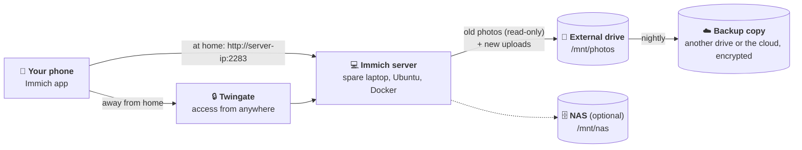

# You need to self-host Google Photos RIGHT NOW!!

**The companion guide to the NetworkChuck Immich video.** 
Take your photos and videos back from Google and Apple. Run Immich on a spare laptop and a hard drive, back up your phone automatically, reach it from anywhere, and search your whole life with local AI. Every command from the video, in order, plus the parts the video goes fast on.

▶ Watch the video: link coming the day it goes live

 

---

## What is Immich?

[Immich](https://immich.app) is a free, open-source replacement for Google Photos and iCloud Photos that you run on your own computer. It does the things you'd miss if you left: automatic phone backup, a timeline, albums, memories ("on this day"), a map, face recognition, and search that understands what's *in* a photo. The AI behind the faces and the search runs on your machine, not in someone's cloud.

## What you'll build

One computer runs Immich in Docker. Your photos live on a drive you can hold. Immich reads the photos you already have and saves new ones from your phone to the same drive. Twingate lets your phone reach it when you're away, without opening anything on your router to the internet.

## The path

Follow it in order. The times are where each part starts in the video.

| # | Chapter | Video | What you'll do |
|---|---------|-------|----------------|
| 1 | [What you need](guide/01-what-you-need.md) | 1:30 | Pick where your photos live and what runs Immich |
| 2 | [Ubuntu Server and Docker](guide/02-ubuntu-and-docker.md) | 3:29 | Install Ubuntu, SSH in, install Docker |
| 3 | [Connect your hard drive](guide/03-connect-your-drive.md) | 4:43 | Mount the drive at every boot, make the upload folder, make Docker wait for it |
| 4 | [Install Immich](guide/04-install-immich.md) | 7:46 | Download the files, edit `.env` and `docker-compose.yml`, start it |
| 5 | [First login and your photos](guide/05-first-login-and-your-photos.md) | 10:38 | Create the admin account, add your old photos as an External Library |
| 6 | [Back up your phone](guide/06-phone-backup.md) | 13:46 | Install the app, pick albums, turn on backup |
| 7 | [Access from anywhere with Twingate](guide/07-twingate.md) | 14:59 | Reach Immich away from home without opening ports |
| 8 | [Add a NAS](guide/08-add-a-nas.md) | 17:06 | Mount an NFS share and add it to Immich |
| 9 | [Give Immich your NVIDIA GPU](guide/09-gpu.md) | 17:36 | Driver, Container Toolkit, the CUDA images, hardware transcoding |
| 10 | [Smarter search](guide/10-smarter-search.md) | 18:29 | Swap in the bigger search model and re-index |
| 11 | [Back it up](guide/11-backups.md) | 21:26 | What Immich backs up for you, and an encrypted off-site copy |
| 12 | [Bring in Google Photos](guide/12-google-takeout.md) | 4:57 | Google Takeout plus `immich-go` |

Also: [Family accounts and the API](guide/extras-family-and-api.md) (20:18 and 22:42) · [Troubleshooting](guide/troubleshooting.md) · [Cheat sheet](guide/cheatsheet.md)

## Before you start

- **A computer to run Immich.** A spare laptop or desktop, a VM, or the Immich app on your NAS. Immich asks for 64-bit Linux, 2 CPU cores and 6 GB of RAM at minimum (4 cores and 8 GB recommended), and an SSD for its database. A GPU is optional; it makes the AI and video conversion faster.
- **Somewhere for your photos.** An external hard drive is enough. A NAS works too.
- **A USB stick** for the Ubuntu installer.
- **Your phone** with the Immich app (iPhone or Android).
- **A free Twingate account** for chapter 7.

> [!NOTE]
> **Tested on Immich v3.4.2 and Ubuntu Server 26.04 (November 2026).** The video was filmed on v3.4.1. Chapters 2 to 5, 8, 11 and 12 and the API examples were run start to finish on a clean Ubuntu 26.04 machine with an exFAT drive and an NFS share, including a reboot. The GPU chapter's compose edits were checked with `docker compose config`, but the driver and toolkit steps follow NVIDIA's and Immich's current docs (no NVIDIA card in the test machine). Twingate follows the video and Twingate's docs.

> [!TIP]
> Placeholders look like `<your-uuid>` or `<server-ip>`. Replace the whole thing, angle brackets included.

## Links

- Immich: [immich.app](https://immich.app) · [docs](https://docs.immich.app) · [GitHub](https://github.com/immich-app/immich)
- Twingate, the sponsor of the video: [ntck.co/twingate_immich](https://ntck.co/twingate_immich)
- Ubuntu Server: [ubuntu.com/download/server](https://ubuntu.com/download/server)
- More from NetworkChuck: [YouTube](https://www.youtube.com/@NetworkChuck) · [NetworkChuck Academy](https://ntck.co/NCAcademy) · [coffee](https://ntck.co/coffee)

## License

[MIT](LICENSE). Immich itself is AGPL-3.0 and made by the Immich team; this repo is only a guide.
