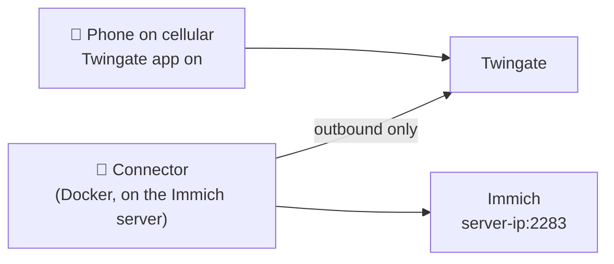

# 7. Access from anywhere with Twingate

▶ Video: 14:59 · [← Back up your phone](06-phone-backup.md) · [Next: Add a NAS →](08-add-a-nas.md)

> Twingate sponsored this video. In the video the link is read as twingate.com/networkchuck; use [ntck.co/twingate-networkchuck](https://ntck.co/twingate-networkchuck).

Away from home, your phone can't reach a server that only lives on your home network. You could open a port on your router and put Immich on the internet, but then anyone can knock on it. Twingate does it the other way around: a small **Connector** inside your network dials out to Twingate, and only devices signed in to *your* Twingate account, running the Twingate app, can reach the one thing you shared. No port forwarding, nothing exposed.



It's not a VPN to your whole network. You share one **Resource** (the Immich server's address), and in step 5 you lock it down to Immich's port, so that's all a device can reach.

## Set it up

1. Sign up at [ntck.co/twingate-networkchuck](https://ntck.co/twingate-networkchuck). The free **Starter** plan covers up to 5 users, plenty for a family ([pricing](https://www.twingate.com/pricing)).
2. Name your network. You end up in the **Admin Console**.
3. **Remote Networks → Add Remote Network.** Location: **On Premise**. Name it `home`.
4. In that network, **Deploy Connector** → choose **Docker**. Twingate generates a `docker run` command with your network's tokens in it. Run it on the Immich server (Docker is already there):

   ```bash
   # paste the command from your Admin Console here; it looks like
   # docker run -d --env TWINGATE_NETWORK="..." --env TWINGATE_ACCESS_TOKEN="..." --env TWINGATE_REFRESH_TOKEN="..." ... twingate/connector:latest
   ```

   Back in the Admin Console, the Connector turns **Connected**.

   > [!CAUTION]
   > That command carries your Connector's access and refresh tokens. Treat it like a password: don't paste it in screenshots, chats or videos. If it leaks, delete the Connector and deploy a new one.

5. **Add Resource.** Name: `immich`. Address: your server's IP. Optional **Alias**: a friendly name like `photos.home` that only works through Twingate. Under **Protocols**, set TCP to **Restrict** with port `2283`, and UDP to **Block All**. (By default a Resource forwards every port, which would also expose SSH and anything else on that server.) Give access to your group (Everyone, to start).
6. On the phone, install the **Twingate** app, sign in to your network, and turn it on.

## Try it

Stay on cellular. Open `http://<server-ip>:2283` (or `http://<your-alias>:2283`) in the phone's browser: Immich loads. The Immich app works too, with the **same** server URL as at home. Videos that wouldn't play a minute ago now play.

To give your family access, invite them in the Admin Console and add them to the Resource's group.

Twingate's docs: [Remote Networks](https://www.twingate.com/docs/remote-networks) · [Connectors](https://www.twingate.com/docs/connectors) · [Resources](https://www.twingate.com/docs/resources) · [Aliases](https://www.twingate.com/docs/resource-aliases)

---

[← Back up your phone](06-phone-backup.md) · [Next: Add a NAS →](08-add-a-nas.md)
